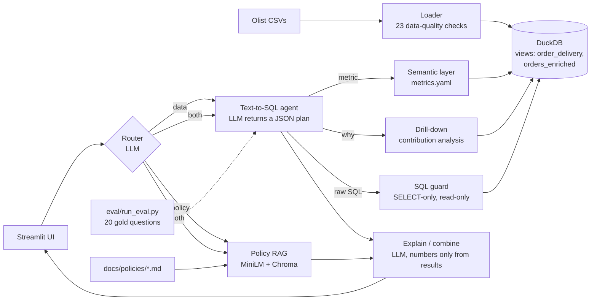

# Late-Delivery Investigator

[](https://github.com/rranjanyyadav/late-delivery-investigator/actions/workflows/ci.yml)

An AI analytics assistant for an e-commerce **operations manager investigating
late deliveries**. It answers questions such as *"Why did on-time delivery drop
in São Paulo in Q3 2018?"* by querying a governed semantic layer, ranking the
sellers, categories and states that contributed most to the change, and
checking the result against the company's delivery policies.

It is not a generic "chat with your CSV" bot: metrics have one agreed
definition, every query is read-only and validated, "why" questions get a
quantitative drill-down, and the agent is measured against a gold evaluation set.

Data: [Olist Brazilian E-Commerce dataset](https://www.kaggle.com/datasets/olistbr/brazilian-ecommerce)
(~99k orders, Sep 2016 – Aug 2018).

## Example

> **Why did on-time delivery drop in São Paulo in Q3 2018?**
>
> The late-delivery rate for customers in SP rose from 2.33% (2018-Q2) to 6.55%
> (2018-Q3), +4.22 percentage points. The rise is broad rather than caused by a
> few sellers: the largest single seller explains 4.6% of it. health_beauty
> stands out, with 21% of the change from 11.6% of the volume (late rate 2.7% →
> 10.3%). Meanwhile the **promised delivery window shrank from 20.3 to 13.4
> days while actual delivery got faster (7.2 → 6.4 days)**: the drop in on-time
> rate comes with tighter promises, not slower logistics.

(Figures computed by the project's drill-down on the real data; the policy
documents used for SLA questions are fictional, written for this project.)

## Architecture



| Module | What it does | Code |
|---|---|---|
| 1. Loader | Loads 9 CSVs into DuckDB, rebuilds from scratch every run, 19 data-quality checks on the raw tables (duplicate IDs, nulls, impossible dates, orphan keys); critical failures exit with code 1 | `ldi/loader.py` |
| 2. Views | `order_delivery` (one row per order) and `orders_enriched` (one row per order line) with `delivery_delay_days`, `is_late` (by calendar day), `promised_days`, revenue; 4 more checks guard their grain | `sql/` |
| 3. Semantic layer | 10 metrics × 8 dimensions in YAML; compiles metric + dimensions + filters into parameterised SQL | `semantic/metrics.yaml`, `ldi/semantic.py` |
| 4. Agent | LLM returns a JSON plan (`metric` / `sql` / `drilldown` / `cannot_answer`); one retry with the error fed back; explanation may only use numbers from the result | `ldi/agent.py`, `ldi/sql_guard.py`, `ldi/llm.py` |
| 5. Drill-down | Splits a ratio metric's change between two periods into per-segment contributions (rate vs mix effect) that sum exactly to the change; compares promised vs actual lead time | `ldi/drilldown.py` |
| 6. RAG + router | Section-level chunks, MiniLM embeddings, Chroma; answers from whole matched policies with `[POL-XX §Section]` citations; routes data / policy / both | `ldi/rag.py`, `ldi/router.py` |
| 7. UI | Answer first; route, SQL, result table, policy sections in expanders; charts chosen by result shape | `app/streamlit_app.py` |
| 8. Evaluation | 20 questions with gold SQL or expected behaviour, execution-based grading, rule-based error categories | `eval/` |

## Setup (Windows, Python 3.11)

```bash
py -3.11 -m venv .venv
.venv\Scripts\activate
pip install -r requirements.txt
```

1. Download the Kaggle dataset and put the 9 CSVs in `data/raw/`.
2. Copy `.env.example` to `.env` and set `GROQ_API_KEY` (free at console.groq.com).
   `LLM_PROVIDER` can also be `gemini` or `ollama` (local, offline).
3. Build the database and the policy index, then start the app:

```bash
python -m ldi.loader
python -m ldi.rag build
streamlit run app/streamlit_app.py
```

Command-line entry points: `python -m ldi.agent "question"`,
`python -m ldi.router "question"`, `python -m ldi.drilldown`,
`python -m ldi.semantic`, `python -m ldi.rag ask "question"`.

## Evaluation

`python eval/run_eval.py --label <name>` runs the agent on
`eval/questions.yaml` and writes a JSON report to `eval/results/`.

- **Set:** 20 questions: 13 semantic-layer metrics (time series, rankings,
  paraphrases, city vs state), 4 raw-SQL (two of them grain traps), 3 that
  must be refused or return no data, 1 "why" drill-down.
- **Grading is execution-based:** the agent's result table is compared with the
  gold SQL's result (row order, column names and extra columns ignored; 0.1%
  tolerance; 93.2 = 0.932). Each failure gets one category by fixed rules:
  wrong metric, wrong join/filter, misread question, hallucinated column,
  execution error. Rate-limit/network failures are reported separately as
  API errors.

Results with Groq `openai/gpt-oss-120b`, temperature 0 (each row is a file in `eval/results/`):

| Run | Change | Correct | Failures |
|---|---|---|---|
| 1 | baseline | **17/20 (85%)** | 2 wrong join/filter (q11, q12), 1 misread (q14) |
| 2 | + grain annotations in the prompt | **19/20 (95%)** | 1 misread (q14) |
| 3 | same code, re-run | **19/20 (95%)** | 1 wrong join/filter (q19) |
| 4 | + drill-down fix | 18/20 | 1 misread (q14); q20 never reached the model (Groq daily token limit, labelled "execution error" in that file, before the API-error category existed) |

**Fix 1 (runs 1 → 2).** In the baseline, raw SQL for order-level questions
used `orders_enriched` (one row per order *line*), so multi-item orders were
counted several times: average review score of on-time orders 4.21 instead of
4.29, 2017 cancellation share 0.554% instead of 0.59%. The prompt now states
each table's grain and that order-level questions use `order_delivery`.

**Fix 2 (run 3 → 4).** Run 3 decomposed the *on-time* rate, whose segment
contributions are dominated by changes in volume share (a rate near 100%
moves with volume, not quality). Code now always decomposes the late rate,
its exact mirror.

## Tests

```bash
python -m pytest
```

133 tests, about 10 seconds, no network or API key (an autouse fixture blocks
all network connections, so a test that tries to reach an API fails). GitHub
Actions runs them on every push and on pull requests to `main`, after a ruff
lint step that fails only on real errors (see `ruff.toml`). The tests build a hand-made
4-order dataset with the real loader and views, where every answer is known
(e.g. Q3 on-time rate must be 0.5 by order, not 2/3 by line). Covered: SQL
guard (13 unsafe statements blocked, read-only connection, file access
disabled), every metric and every allowed dimension compiles and runs, known
metric values, loader checks catch injected duplicates and impossible dates,
drill-down contributions sum to the change, agent retry/refusal flow with a
scripted fake LLM, eval grader, policy chunking. The suite was checked by
injecting two bugs (timestamp-level lateness, missing `DISTINCT`): both were
caught by 6 failing tests.

## Limitations

- **Small eval set.** 20 questions written by the same person who made the fixes,
  one run per configuration. Treat 85% → 95% as evidence that the fix worked,
  not as a general accuracy figure.
- **Ambiguous questions are not clarified.** q14 ("average freight for SP and
  RJ") is answered as one combined number in some runs and per state in others.
- **Data coverage.** Purchases after August 2018 are incomplete (20 orders,
  none delivered); 2018-Q3 is effectively July–August.
- **Drill-down shows where, not why.** Contributions are associations;
  multi-category orders appear in several segments (reported as a residual).
- **RAG.** Only two policy documents so far, both fictional. With so few chunks
  the distance cut-off alone cannot separate relevant from off-topic questions
  (0.715 vs 0.725 in testing); the LLM's "not covered" rule is the second guard.
  Monthly policy targets are sometimes checked against quarterly rates.
- **Single-user prototype.** One shared DuckDB connection, no authentication,
  no query timeout.
- **Free-tier LLM.** Groq allows 200k tokens/day for this model; a full eval run
  uses roughly a third of that.

## Roadmap

- FastAPI endpoint for the agent, with a connection per request
- Dockerfile
- Bigger eval set (50+ questions, some written by someone else), several runs
  per configuration reported as mean and spread, plus a held-out test split
- Same eval on a local model through Ollama, for a cost/privacy/accuracy comparison
- Clarifying questions for ambiguous requests; remaining policy documents
